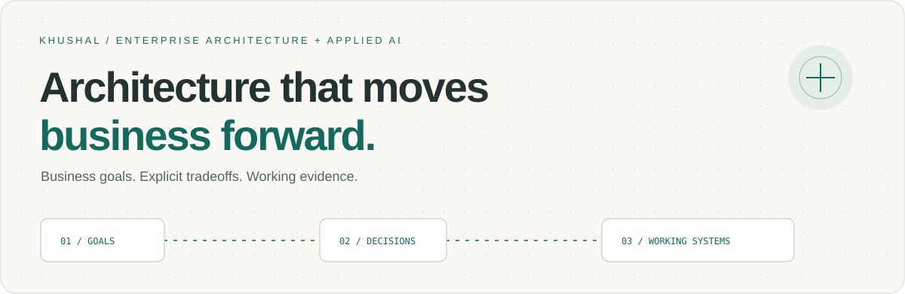
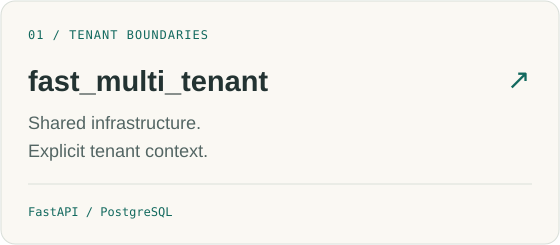
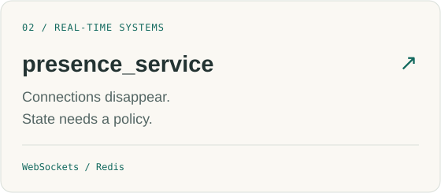
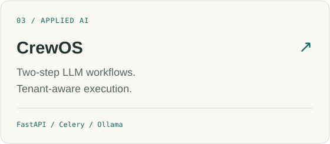
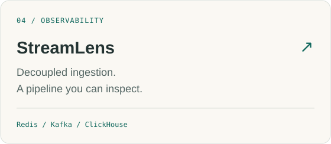

  <a href="https://khushal075.github.io/"> &nbsp;<strong>Explore my portfolio ↗</strong></a> &nbsp; · &nbsp;
  <a href="https://khushal075.github.io/blog/"> &nbsp;Architecture notes</a> &nbsp; · &nbsp;
  <a href="https://khushal075.github.io/#playground"> &nbsp;Interactive playground</a> &nbsp; · &nbsp;
  <a href="https://linkedin.com/in/khushal108"> &nbsp;LinkedIn</a>

## Business intent → architecture decisions → working evidence

I connect business priorities with **enterprise architecture and applied AI**: defining system boundaries, making tradeoffs explicit, and validating decisions in working software.

My foundation is **7+ years of production ownership across Python and Java**, spanning distributed backends, multi-tenant platforms, and real-time communication. Here I share the code and reasoning behind those decisions.

| The question I start with | What I make explicit |
| :--- | :--- |
| What are we promising the customer? | Service boundaries, recovery expectations, and cost to serve |
| What stays shared? | Tenant scope, resource contention, and failure domains |
| Where does AI add value? | Workflow boundaries, model integration, and execution controls |

## Explore the systems

 

**Want to interact with a system?** [Disconnect a simulated node and watch presence state change in the playground →](https://khushal075.github.io/#playground)

## Latest architecture notes

<!-- BLOG:START -->
- [Efficient agents need a workflow, not just a stronger model](https://khushal075.github.io/blog/efficient-agents-need-a-workflow/)
- [An AI workflow needs execution boundaries](https://khushal075.github.io/blog/ai-execution-needs-boundaries/)
- [When a connection disappears, when is a user offline?](https://khushal075.github.io/blog/presence-is-a-decision/)
- [Tenant isolation is a business decision](https://khushal075.github.io/blog/tenant-isolation-is-a-business-decision/)
<!-- BLOG:END -->

[All articles →](https://khushal075.github.io/blog/) · [Subscribe via RSS](https://khushal075.github.io/rss.xml)

This reading list refreshes daily from my blog.

<strong>Applied AI: what CrewOS demonstrates today</strong>

CrewOS currently executes a **fixed two-step LLM workflow** with tenant authentication, task-ownership checks, tenant-specific Celery routing, bounded inference retries, and an OpenAI-compatible model adapter. Ollama is a local inference option.

Tool-using agent loops, persistent memory, durable checkpoints, approvals, and multi-agent evaluation are planned. The architecture articles discuss broader patterns separately from implemented project capabilities.

[Inspect the implementation →](https://github.com/khushal075/crewos)

<strong>Production experience, toolkit, and education</strong>

My work includes multi-tenant notification platforms, WebSocket communication and presence systems, client data-migration pipelines, and reusable platform libraries.

**Languages & frameworks:** Python · Java · FastAPI · Django · Spring Boot  
**Data & messaging:** PostgreSQL · Redis · Snowflake  
**Infrastructure:** AWS · GCP · Kubernetes · Docker · Prometheus · Grafana

**M.Tech — IIT Kanpur** (2012–2015)  
**B.Tech — Engineering College, Bikaner** (2007–2011)

---

**Let’s connect:** [LinkedIn](https://linkedin.com/in/khushal108) · [Email](mailto:khushal.jobss@gmail.com) · [Portfolio](https://khushal075.github.io/)

Open to conversations about enterprise architecture, Staff Engineer, and technical leadership opportunities.
